<p align="center">
  <!-- Replace these images with the Farlands logo or a stylized screenshot -->
  <picture>
    <source media="(prefers-color-scheme: dark)" srcset="docs/assets/hero-dark.svg">
    
  </picture>
</p>

<p align="center">
  <b>An infinite voxel game engine, built from scratch in native C++.</b><br>
  Eliminate the bottlenecks of Java and C#.<br>
  Multithreaded world generation, Greedy Meshing, and ultra-optimized Vulkan rendering.
</p>

<p align="center">
  <a href="https://github.com/M-U-C-K-A/farlands/releases"></a>
  <a href="https://github.com/M-U-C-K-A/farlands/actions/workflows/build.yml"></a>
  
  
  
  
</p>

<p align="center">
  <a href="https://github.com/M-U-C-K-A/farlands/archive/refs/heads/main.zip"></a>
</p>

<p align="center">
  <a href="#quick-start">Quick start</a> ·
  <a href="#why-farlands">Architecture</a> ·
  <a href="#tech-stack">Tech Stack</a> ·
  <a href="#roadmap">Roadmap</a> ·
  <a href="#development">Development</a>
</p>

---

## Quick start

> [!WARNING]
> **Pre-Alpha**: The project is currently in intensive development. The API and architecture are subject to major changes.

Grab the source code and initialize the dependencies:

```bash
# Clone the repository
git clone [https://github.com/M-U-C-K-A/farlands.git](https://github.com/M-U-C-K-A/farlands.git)
cd farlands

# Initialize submodules (Vulkan, GLFW, GLM)
git submodule update --init --recursive

```

---

## Why Farlands?

Most Minecraft clones suffer from performance issues related to memory management (Garbage Collection) or aging graphics APIs (OpenGL). Farlands tackles these issues at their core by rethinking the rendering pipeline and data management.

| Concept | How Farlands solves it |
| --- | --- |
| **Graphics Overhead** | **Vulkan API** communicates directly with the GPU. No more heavy drivers, allowing full control over video memory and render queues. |
| **GC Lag** | **Native C++20** allows for manual memory allocation and deallocation. No unpredictable pauses to clean up RAM. |
| **Polygon Overload** | **Greedy Meshing** merges adjacent visible faces, drastically reducing draw calls and geometric load. |
| **Blocking Generation** | The **Multithreaded** architecture isolates chunk loading, procedural generation, and rendering on separate threads. |

---

## Tech Stack

| Component | Technology | Description |
| --- | --- | --- |
| **Core & Logic** | `C++20` | Systems language for raw, predictable performance. |
| **3D Rendering** | `Vulkan SDK` | Modern low-level graphics pipeline. |
| **Shaders** | `GLSL` | Compiled to `SPIR-V` to be consumed by Vulkan. |
| **Windowing** | `GLFW` | Window creation and fine-grained input management (keyboard/mouse). |
| **Mathematics** | `GLM` | Industry-standard library for 3D linear algebra. |

---

## Roadmap

* [ ] Complete render pipeline with Command Buffer management.
* [ ] On-the-fly compiled GLSL shaders.
* [ ] Dynamic lighting system.
* [ ] SSAO (Screen Space Ambient Occlusion) for visual depth.

* [ ] Infinite world based on a 3D Chunk system.
* [ ] Procedural generation via Perlin / Simplex noise.
* [ ] Dynamic background geometry loading and unloading.
* [ ] Greedy Meshing algorithm to optimize vertex buffers.

* [ ] Optimized AABB collision detection for voxel environments.
* [ ] Camera movement and physics controls (gravity, jumping).
* [ ] Basic world interaction (breaking/placing blocks).

---

## Development

The project uses `CMake` for cross-platform builds. Ensure you have the Vulkan SDK and a C++20 compatible compiler installed.

```bash
# Create the build directory
mkdir build && cd build

# Generate configuration files
cmake ..

# Build the project
cmake --build .

# Run the engine
./farlands

```

---

## License

[MIT](https://www.google.com/search?q=LICENSE) - Created by [M-U-C-K-A](https://www.google.com/search?q=https://github.com/M-U-C-K-A).
