<p align="center">
  
</p>

<p align="center">
  <b>A Minecraft-style voxel engine written from scratch in C++20 and Vulkan.</b><br>
  Infinite procedural terrain · 8 biomes · chunk streaming with on-disk persistence · per-vertex ambient occlusion · F3-style debug overlay
</p>

<p align="center">
  <a href="#roadmap"></a>
  
  
  
  
  
</p>

<p align="center">
  <a href="https://github.com/M-U-C-K-A/Farlands/archive/refs/heads/main.zip"></a>
</p>

<p align="center">
  <a href="#screenshots">Screenshots</a> ·
  <a href="#features">Features</a> ·
  <a href="#quick-start">Quick start</a> ·
  <a href="#how-it-works">How it works</a> ·
  <a href="#project-layout">Project layout</a> ·
  <a href="#roadmap">Roadmap</a> ·
  <a href="#development">Development</a>
</p>

---

## Screenshots

<p align="center">
  
</p>

<table>
  <tr>
    <td width="50%">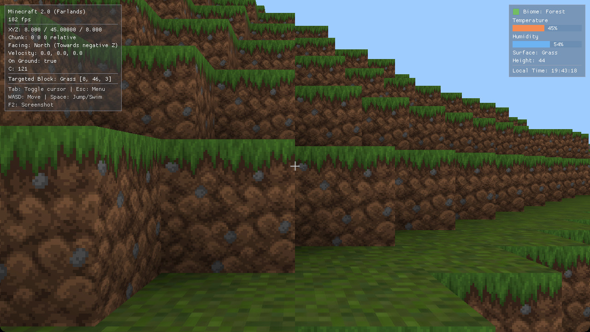</td>
    <td width="50%">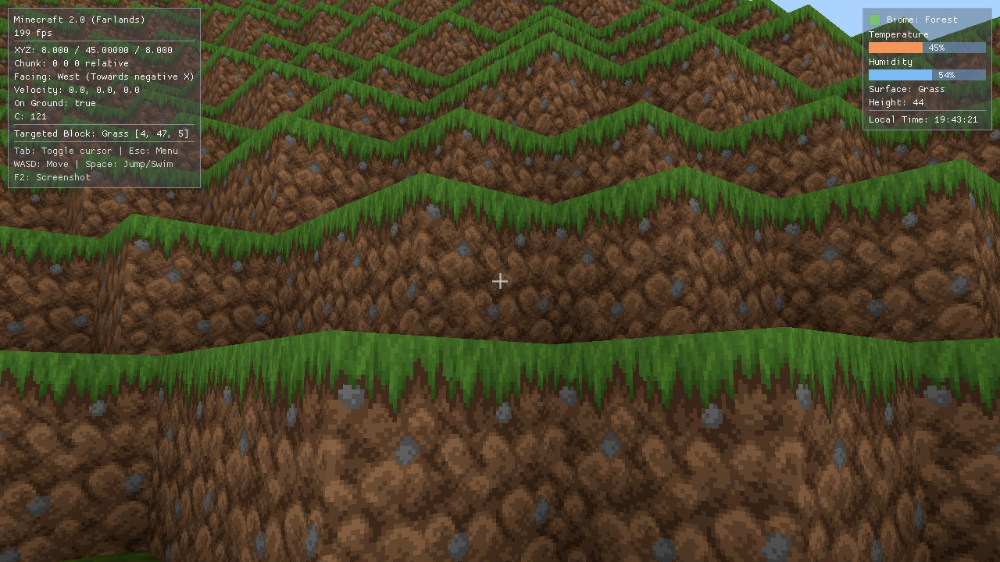</td>
  </tr>
  <tr>
    <td align="center"><sub><b>Spawn</b> — forest terraces, textures from the 2D texture array</sub></td>
    <td align="center"><sub><b>Hills</b> — per-vertex AO darkens every step and corner</sub></td>
  </tr>
  <tr>
    <td width="50%"></td>
    <td width="50%"></td>
  </tr>
  <tr>
    <td align="center"><sub><b>Underwater</b> — short-range water fog, surface rendered from below</sub></td>
    <td align="center"><sub><b>Main menu</b> — Dear ImGui over a scrolling panorama</sub></td>
  </tr>
</table>

<p align="center"><sub>Real frames from <code>build/farlands</code> (Release) on an Apple M4 through MoltenVK, 1280×720, no post-processing — 160–200 FPS with the overlay on.</sub></p>

---

## Features

<table>
  <tr>
    <td valign="top" width="50%">

**🎨 Rendering**
- Hand-written **Vulkan** renderer: instance, device, swapchain (3 images), **2 frames in flight**, MoltenVK portability on macOS
- **Sky pass** — one fullscreen triangle rebuilding view rays from the inverse matrices, with a sun disk and halo
- **Terrain pass** — every loaded chunk in a single `vkCmdDrawIndexed`
- Block textures in one **2D texture array** (18 layers, 64×64, 7 mip levels)
- Directional sun + ambient, **baked per-vertex AO**, distance fog tied to the render distance, **underwater fog**
- **F2 screenshots** straight from the swapchain to PNG

</td>
    <td valign="top" width="50%">

**🌍 World**
- **Infinite** X/Z world of 16 × 256 × 16 chunks
- Streaming: load radius 5 (**121 chunks**), unload beyond 7 (hysteresis)
- In-house **Perlin fBm** — 5 noise fields, fixed seed 42
- **8 biomes**: Ocean, Beach, Plains, Forest, Desert, Mountains, Snowy Tundra, Swamp
- Water up to sea level 30, strata (surface → sub-surface → stone → bedrock), biome-tinted grass & leaves
- **RLE chunk files** in `~/.farlands/world`, versioned and self-healing

</td>
  </tr>
  <tr>
    <td valign="top">

**🧍 Player**
- First-person controller with frame-rate independent movement
- Gravity, jumping, **swimming** (reduced gravity and speed in water)
- **Per-axis AABB collisions** (0.6 × 1.8 hitbox)
- Spawns on the terrain surface

</td>
    <td valign="top">

**🛠️ Tooling**
- **F3-style overlay** (Dear ImGui): FPS, XYZ, chunk, facing, velocity, targeted block, biome / temperature / humidity
- Data-driven blocks: **`assets/data/blocks.json`**
- Coloured, timestamped logger (`INFO` … `FATAL`); `DEBUG` / `TRACE` compiled out in Release
- CMake compiles GLSL → SPIR-V; Debug builds enable the **Vulkan validation layers**

</td>
  </tr>
</table>

---

## Quick start

> [!WARNING]
> **Pre-alpha** — Farlands is under heavy development. Expect breaking changes in the code, the save format and the controls.

**1. Get the code** (Dear ImGui is a git submodule):

```bash
git clone --recursive https://github.com/M-U-C-K-A/Farlands.git
cd Farlands

# Already cloned without --recursive? Fetch ImGui:
git submodule update --init --recursive
```

**2. Install the prerequisites:**

```bash
# macOS (Homebrew) — tested
brew install cmake glfw glm vulkan-headers vulkan-loader molten-vk shaderc
```

```bash
# Debian / Ubuntu — untested, package names may vary
sudo apt install cmake g++ libglfw3-dev libglm-dev libvulkan-dev glslc
```

**3. Build and run:**

```bash
cmake -S . -B build
cmake --build build -j
./build/farlands
```

<p align="center">
  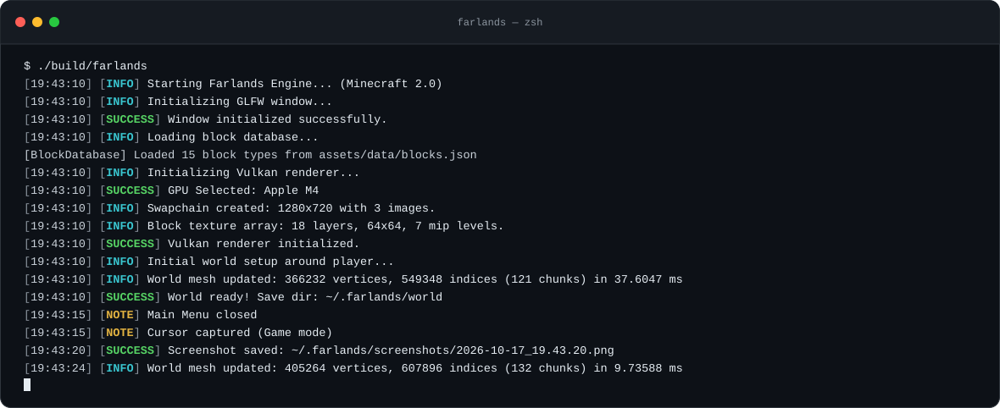
</p>

### Controls

| Key | Action |
| --- | --- |
| <kbd>W</kbd> <kbd>A</kbd> <kbd>S</kbd> <kbd>D</kbd> | Move |
| <kbd>Space</kbd> | Jump · swim up |
| Mouse | Look around |
| <kbd>Tab</kbd> | Toggle mouse capture |
| <kbd>Esc</kbd> | Back to the main menu |
| <kbd>F2</kbd> | Screenshot → `~/.farlands/screenshots/` |

The world is saved to `~/.farlands/world/`. Delete that folder to start from a fresh world.

---

## How it works

### One frame

Everything runs on the main thread. Each frame polls GLFW, moves the player, updates the camera and the ImGui overlay, then records one command buffer with three passes. World work (loading, generation, meshing, upload) only happens on the frame where the player enters a new chunk.

<p align="center">
  
</p>

### Infinite world streaming

`World::updateAroundPlayer()` keeps every chunk within **5 chunks** of the player in memory and frees those more than **7** away. The 2-chunk gap is hysteresis: walking back and forth over a border does not reload anything. A chunk is read from disk when possible, otherwise generated and saved right away. Its four neighbours are flagged dirty so the seams get remeshed.

<p align="center">
  
</p>

### Terrain generation

`BiomeManager::getHeightAt()` adds three Perlin fBm layers: slow **continents**, small **hills**, and **ridges** (`(1 − |n|)²`) weighted towards high ground. Very low areas are pushed down to make oceans. Columns are filled with bedrock, stone, a sub-surface layer and a surface block, then water up to sea level.

<p align="center">
  
</p>

The biome is picked by **first match**: terrain height decides oceans, beaches and mountains, then temperature × humidity decide the rest. The map below is rendered by the engine's own `BiomeManager` for seed 42.

<p align="center">
  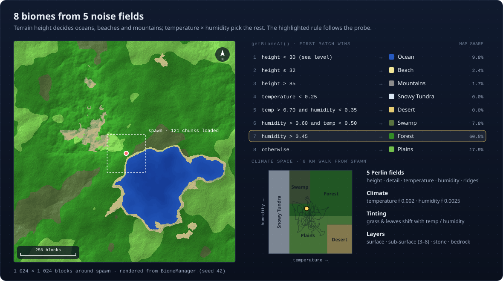
</p>

### Meshing & lighting

`generateChunkMesh()` walks the 65 536 blocks of a chunk and emits a face only if the neighbour is air or a different transparent block. It looks into neighbouring chunks, and treats chunks that aren't loaded yet as solid so no wall appears at the edge of the world. Each vertex stores an **ambient occlusion** factor computed from its three neighbours (two sides + corner), as in the classic *0fps* technique.

<p align="center">
  
</p>

The terrain fragment shader then combines everything:

```glsl
// simplified from shaders/shader.frag
vec4  tex      = texture(texSampler, uvLayer) * vec4(vertexColor, 1.0);  // texture array + biome tint
float lighting = 0.35 + 0.65 * max(dot(normal, sunDir), 0.0);            // ambient + sun
float ao       = mix(0.15, 1.0, vertexAO);                                // baked occlusion
vec3  color    = mix(tex.rgb * lighting * ao, fogColor, fogFactor);       // distance / underwater fog
```

### Blocks

Blocks are data-driven: `BlockDatabase` loads `assets/data/blocks.json` at start-up. Each entry gives its flags and one texture per face, and the renderer packs every face texture into the texture array.

<p align="center">
  
</p>

```json
{
  "id": 2,
  "name": "Grass",
  "transparent": false,
  "solid": true,
  "hardness": 0.6,
  "color": [0.36, 0.58, 0.28],
  "colorTop": [0.46, 0.72, 0.31],
  "texture": "textures/block/grass_block_side.png",
  "textureTop": "textures/block/grass_block_top.png",
  "textureBottom": "textures/block/dirt_side.png"
}
```

### Saving

Chunks are stored x-first, then y, then z, so whole underground layers collapse into a few runs of `[type: u8][count: u16]`. A file starts with a magic number and a version. Older or corrupted files are simply regenerated.

<p align="center">
  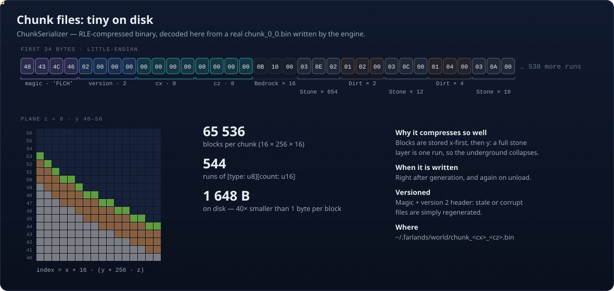
</p>

---

## Project layout

```text
Farlands/
├── src/
│   ├── main.cpp               entry point, global exception guard
│   ├── app.{h,cpp}            Application — window, main loop, input, HUD, UBO
│   ├── core/                  logger.h (coloured logs) · types.h (Vertex, UBO) · stb_* (image I/O)
│   ├── renderer/
│   │   ├── renderer.*         frame orchestration, ImGui, F2 screenshots
│   │   ├── vk_context.*       instance, device, queues, validation layers
│   │   ├── vk_swapchain.*     swapchain, depth buffer, framebuffers
│   │   ├── vk_pipeline.*      render pass, terrain + sky pipelines
│   │   ├── vk_buffers.*       vertex / index / uniform buffers, descriptors
│   │   ├── vk_texture.*       block texture array (+ mipmaps), UI textures
│   │   └── camera.*           view & projection matrices
│   ├── world/
│   │   ├── world.*            chunk map, streaming, world mesh assembly
│   │   ├── chunk.*            16×256×16 block storage
│   │   ├── chunk_mesh.*       face culling + per-vertex AO
│   │   ├── chunk_serializer.* RLE chunk files
│   │   ├── biome.*            BiomeManager — height, climate, biome rules
│   │   ├── noise.*            Perlin noise + fBm octaves
│   │   └── block.*            BlockDatabase (JSON)
│   ├── player/player.*        first-person controller, physics, AABB
│   └── ui/menu.*              main menu
├── shaders/                   shader.{vert,frag} (terrain) · sky.{vert,frag} · compile.sh
├── assets/                    data/blocks.json · textures/ · Farlands.png (logo)
├── external/                  imgui (submodule) · nlohmann/json.hpp
└── docs/assets/               README visuals and screenshots
```

### Tuning knobs

| What | Where | Default |
| --- | --- | --- |
| Render distance | `RENDER_RADIUS` in `src/app.h` | 5 chunks (unloads at 7) |
| World seed | `m_biomeManager{42}` in `src/world/world.h` | 42 |
| Sea level | `SEA_LEVEL` in `src/world/biome.h` | 30 |
| Chunk size | `CHUNK_SIZE_*` in `src/world/chunk.h` | 16 × 256 × 16 |
| Physics | `GRAVITY`, `JUMP_VELOCITY`, `MOVE_SPEED` in `src/player/player.h` | −20 · 8 · 6 |
| Fog | `fogRange` in `src/app.cpp` | 60 % → 100 % of the render distance |
| Sun direction | `shaders/shader.frag`, `shaders/sky.frag` | `normalize(0.4, 1.0, 0.3)` |

---

## Roadmap

**Done**

- [x] Vulkan bootstrap — instance, device, swapchain, render pass, terrain & sky pipelines (MoltenVK-ready)
- [x] JSON block database, texture array with per-face layers and mipmaps
- [x] First-person controller — delta time, gravity, jump, swimming, AABB collisions
- [x] Procedural terrain — Perlin fBm, 8 biomes, water, biome tinting
- [x] Infinite world — chunk streaming with hysteresis, RLE persistence
- [x] Face culling, per-vertex ambient occlusion, sun lighting, distance & underwater fog
- [x] Dear ImGui debug overlay, main menu, F2 screenshots

**Next**

- [ ] Multithreaded chunk generation and meshing (job system)
- [ ] One GPU buffer per chunk instead of re-uploading the whole world mesh
- [ ] Greedy meshing
- [ ] Frustum culling
- [ ] Translucent pass for water, glass and leaves (blending + sorting)
- [ ] Breaking and placing blocks — the targeted block is already ray-marched for the overlay
- [ ] Trees (`treeDensity` is already in `BiomeData`), caves and ores
- [ ] Snow surface for the Snowy Tundra
- [ ] Options menu — render distance, FOV, mouse sensitivity
- [ ] Day / night cycle and dynamic lighting

---

## Development

You need:

- a C++20 compiler (Clang, GCC or MSVC),
- the Vulkan loader + headers (or the [Vulkan SDK](https://vulkan.lunarg.com/); on macOS, MoltenVK),
- `glslc` (shipped with the Vulkan SDK, or `brew install shaderc`),
- GLFW 3.3+ and GLM.

```bash
# Configure (Release by default)
cmake -S . -B build

# Build the engine and compile the shaders to SPIR-V
cmake --build build -j

# Run the engine
./build/farlands
```

For a debug build with the Vulkan validation layers and the `DEBUG` / `TRACE` logs (`brew install vulkan-validationlayers` on macOS):

```bash
cmake -S . -B build-debug -DCMAKE_BUILD_TYPE=Debug
cmake --build build-debug -j
VK_LAYER_PATH=/opt/homebrew/opt/vulkan-validationlayers/share/vulkan/explicit_layer.d ./build-debug/farlands
```

- Shaders are recompiled by CMake whenever a `.vert` / `.frag` changes. `shaders/compile.sh [out_dir]` does the same by hand.
- Formatting follows the repository's `.clang-format`.
- Asset paths (`ASSETS_DIR`) and shader paths (`SHADER_DIR`) are baked in at configure time, so the binary can be launched from any directory.

---

## Credits

- [Dear ImGui](https://github.com/ocornut/imgui) — UI and debug overlay
- [GLFW](https://www.glfw.org/) — window and input · [GLM](https://github.com/g-truc/glm) — maths
- [nlohmann/json](https://github.com/nlohmann/json) — block database parsing
- [stb](https://github.com/nothings/stb) — `stb_image`, `stb_image_write`, `stb_image_resize2`
- [MoltenVK](https://github.com/KhronosGroup/MoltenVK) — Vulkan on macOS

Farlands is a personal project, not affiliated with Mojang Studios or Microsoft. Some placeholder textures in `assets/textures/` follow the Minecraft resource-pack layout; they belong to their respective owners and are not covered by this project's license.

## License

Released under the MIT License — created by [M-U-C-K-A](https://github.com/M-U-C-K-A).
